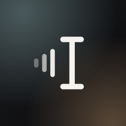

<p align="center">
  
</p>

# Shepit

Shepit (шепіт, Ukrainian for "a whisper") is a dictation app for macOS. Hold a key, speak Ukrainian or
English, let go, and the text appears where your cursor is: in Terminal, a chat, an editor, a browser.

Speech recognition runs on your Mac. If you already use Claude Code or Codex, Shepit can hand the
recognized text to it to fix punctuation, names and code terms before inserting it.

## Features

- On-device recognition: Whisper large-v3-turbo through WhisperKit, or Parakeet v3 through
  FluidAudio. The audio never leaves the Mac.
- Ukrainian, English and both in one sentence: English terms said inside Ukrainian speech come
  out in Latin script. "зроби рефакторинг хендл сабміт" becomes "Зроби рефакторинг handleSubmit".
- Words while you speak: the widget shows what it hears as you talk.
- Long dictations finish sooner: Whisper transcribes in pieces while you are still speaking. A
  46-second prompt is ready about 4 seconds after you let go.
- Optional polishing: pick Claude Code, Codex or nothing. With an agent, Shepit fixes
  punctuation, self-corrections ("на п'яту, ні, на шосту"), filler words and identifiers. Without
  one, the text goes in as heard, with spacing, capitals and dictionary terms fixed locally.
- A dictionary that grows: names and terms the recognizer gets wrong. Terms the agent corrects
  are added on their own.
- Three widget styles: flow pill, caption bar or island, on black glass. Drag the widget
  anywhere and it stays there.

## Requirements

- macOS 26. Built and tested on an M1 with 16 GB of memory.
- About 1.6 GB of disk for the speech models, downloaded on first use.
- For polishing (optional): [Claude Code](https://claude.ai/code) or
  [Codex](https://github.com/openai/codex), installed and signed in.

## Install

1. Download `Shepit-<version>.zip` from [Releases](https://github.com/themarchenko/shepit/releases),
   unzip it and move `Shepit.app` to `/Applications`.
2. The app is not notarized, so macOS blocks the first launch. Open it once, then go to System
   Settings → Privacy & Security and click **Open Anyway**. Or run this in Terminal:

   ```
   xattr -dr com.apple.quarantine /Applications/Shepit.app
   ```

3. Grant Microphone and Accessibility. Accessibility lets Shepit notice the key in any app and
   paste the text at your cursor. Release builds are signed ad hoc, so after an update macOS may ask
   for Accessibility again.

## Use

| Do this | To |
|---|---|
| Hold Right Option, speak, release | Dictate |
| Double tap Right Option | Dictate hands-free; tap once to stop |
| Esc | Cancel |

The key, language, recognizer, widget style and polishing agent are in Settings, from the menu bar
icon. A short tour runs on first launch.

## Privacy

- Audio is recorded and recognized on your Mac. The last 200 recordings are kept in
  `~/Library/Application Support/Shepit/recordings/` so you can compare recognizers on your own
  voice. Delete the folder whenever you like.
- With polishing on, the agent you picked receives the recognized text and some context about where
  it goes: the app name, window title, page URL in browsers, up to 500 characters before the cursor
  and any selected text. The agent then sends that to Anthropic or OpenAI under your own account.
  Turn polishing off and nothing leaves the Mac.
- Password fields are detected and nothing is inserted into them.

## Build from source

You need Xcode 26 and [XcodeGen](https://github.com/yonaskolb/XcodeGen).

```
brew install xcodegen
make install     # Release build, copied to /Applications
make test        # unit tests of ShepitCore
make logs        # live logs from the running app
```

Builds are signed ad hoc, which means macOS forgets the Accessibility permission on every rebuild.
To keep it, sign with your own Apple Development identity: see `Config/Signing.xcconfig`.

`shepit-smoke` runs the recognizers and the polishing step without the app, for example to
compare engines on your own recordings:

```
cd Packages/ShepitCore
swift run -c release shepit-smoke --audio "$HOME/Library/Application Support/Shepit/recordings" \
    --engine parakeet-v3 --engine whisper-turbo --no-claude
```

## Project layout

- `Packages/ShepitCore`: audio, hotkey gestures, recognizers, live preview, polishing agents,
  insertion, history and settings. Everything that can be tested with `swift test`.
- `Shepit/`: the app itself. Widget, Settings, welcome tour, menu bar item.
- `docs/PLAN.md` and `docs/DECISIONS.md`: the plan and a dated log of decisions and measurements.
- `CLAUDE.md` and `.claude/agents/`: notes and subagents for working on the code with Claude Code.

## Contributing

Issues and pull requests are welcome. `main` takes changes through pull requests only, merged with
squash, so the history stays linear. Releases are tags `vX.Y.Z`; CI builds and publishes them.

## Thanks

[WhisperKit](https://github.com/argmaxinc/argmax-oss-swift) by Argmax,
[FluidAudio](https://github.com/FluidInference/FluidAudio) by Fluid Inference,
[GRDB](https://github.com/groue/GRDB.swift), OpenAI's Whisper and NVIDIA's Parakeet models.

## License

MIT. See [LICENSE](LICENSE).
